<div align="center">
  
  <h1>AudioTab</h1>
  <p><b>⌘Tab'ı pencere pencere yeniden düşünen, sesi tek tuşla değiştiren, ekranı bölen menü çubuğu uygulaması.</b></p>

  <a href="https://github.com/demirciemre/audiotab/releases/latest"></a>
  
  
  <a href="LICENSE"></a>

  <p>
    <a href="#pencere-geçişi">Pencere geçişi</a> ·
    <a href="#ses">Ses</a> ·
    <a href="#ekranı-böl">Ekranı böl</a> ·
    <a href="#ekran-görüntüsü-ve-kayıt">Ekran görüntüsü</a> ·
    <a href="#harici-monitörler">Monitörler</a> ·
    <a href="#kurulum">Kurulum</a>
  </p>
</div>


> [!NOTE]
> Görseller özellikleri anlatmak için çizilmiş temsili ekranlardır. Uygulama adları ve simgeler geneldir.

## Pencere geçişi

### Uygulama değil, pencere

⌘Tab, açık her pencereyi ayrı bir kart olarak gösterir: diğer masaüstlerindekiler, tam ekrandakiler ve tarayıcı profilleri dahil. ⌘ basılıyken Tab ile ilerleyin, bırakınca o pencere öne gelir. Panel tuşa basıldıktan 60–95 ms sonra ekrandadır; çok hızlı bir ⌘Tab'da hiç çizilmeden geçer.

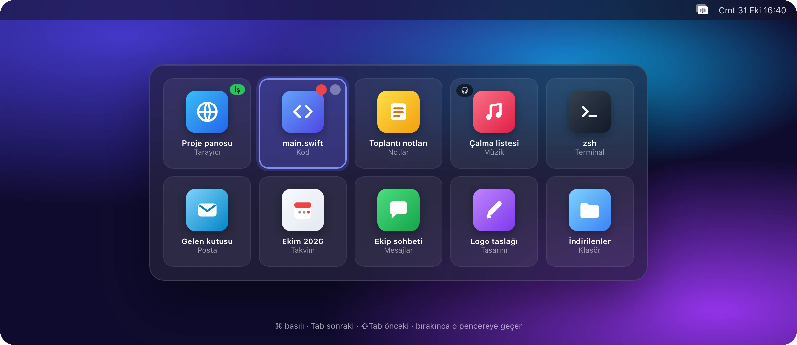

### Canlı önizlemeler

⌥Tab aynı geçişi pencerelerin canlı önizlemeleriyle yapar. Pencere çoksa önizlemeler okunur bir boyutta kalır ve panel kendi içinde kayar: Tab ile ya da trackpad ile. Kenardaki yazı yukarıda ve aşağıda kaç pencere daha olduğunu söyler.

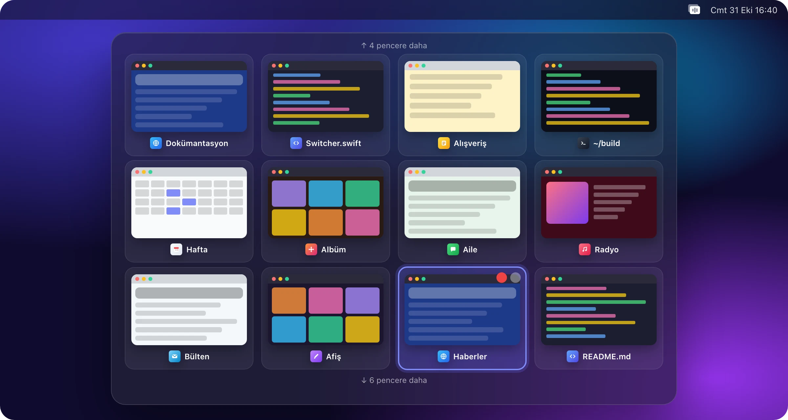

### Gruplu görünüm

Pencereler Tarayıcılar, Projeler, Geliştirme, Uygulamalar ve Klasörler sütunlarında toplanır. Proje uygulamalarında (video, tasarım, müzik yazılımları) pencere başlığından proje adı okunur. Listede olmayan uygulamaları Projeler'e siz ekleyebilirsiniz.


### Filtre ve favoriler

Üstteki çubuktan tek bir uygulamanın pencerelerine daraltın (F ve A). Sağdaki kenar çubuğu sık kullandığınız klasörleri ve Finder favorilerini tek tıkla açar.

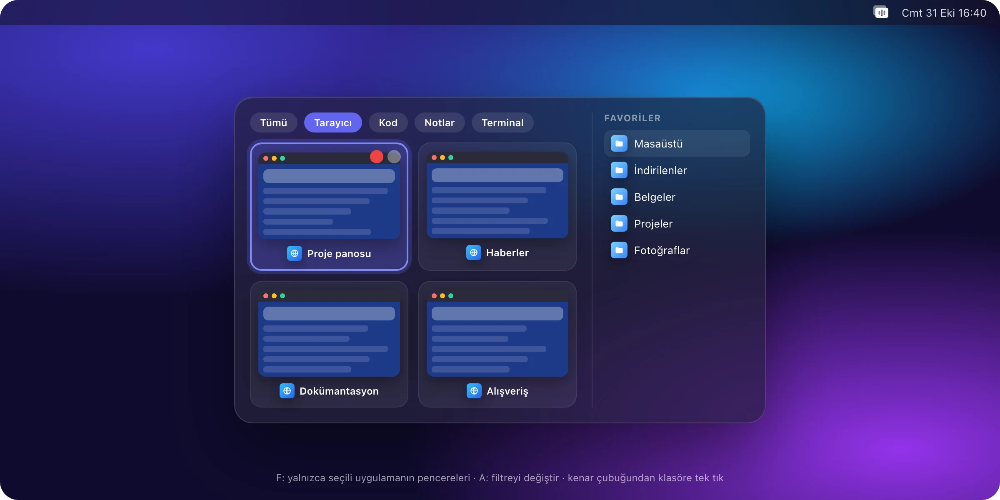

### Panelden yönetin

Panel açıkken pencereyi kapatın, küçültün, gizleyin, uygulamadan çıkın ya da ses cihazını değiştirin. Fareyi kullanmanız gerekmez.

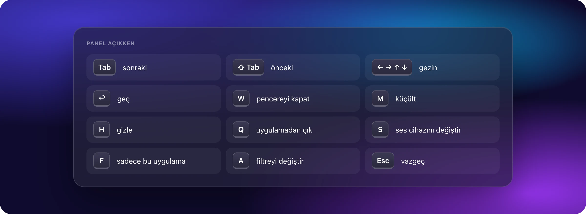

## Ses

### Tek tuşla ses çıkışı

⌘ basılıyken ⇧'ye dokunun: ses sıradaki cihaza geçer (dilerseniz ⌘⇪). Çıkardığınız kulaklığı hatırlar, takınca geri döner.

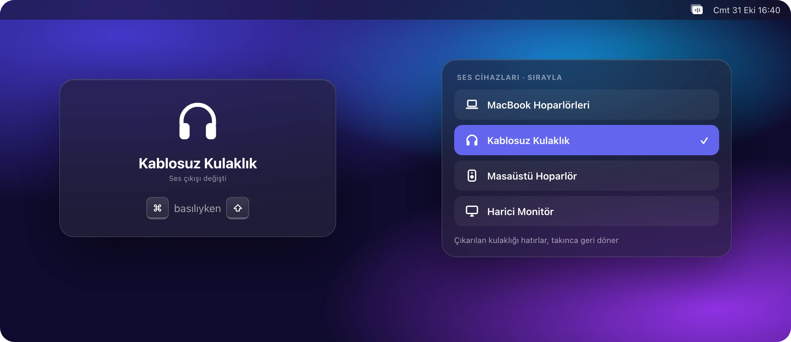

### Uygulamaya göre ses cihazı

Her uygulamaya bir ses cihazı atayın: müzik hoparlörden, görüntülü görüşme kulaklıktan. Atama ⌘Tab kartında rozet olarak görünür, panelde S ile değişir.

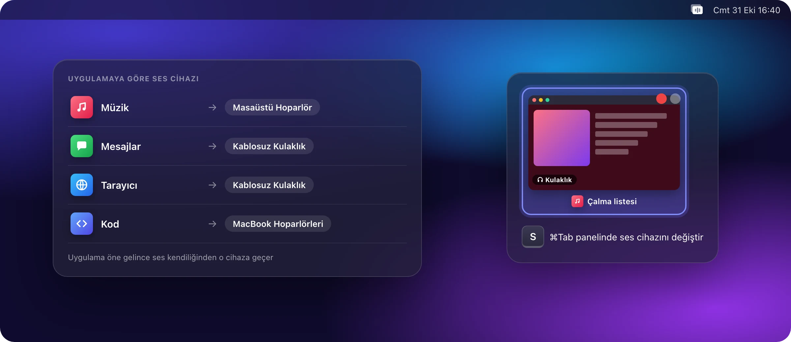

## Ekranı böl

⌘< ile seçici açılır: 9 düzenden birini seçin, pencereleri bölmelere yerleştirin. Birden fazla monitörde hedef ekranı Tab ile değiştirirsiniz. Her ekranda büyük bir numara hangisinin hedef olduğunu gösterir.


## Ekran görüntüsü ve kayıt

⌘⇧3 imlecin bulunduğu ekranı, ⌘⇧4 bir alanı yakalar. ⌘⇧5 paleti açar; MP4 (H.264), H.265 ya da ProRes 4444 kayıt alır.

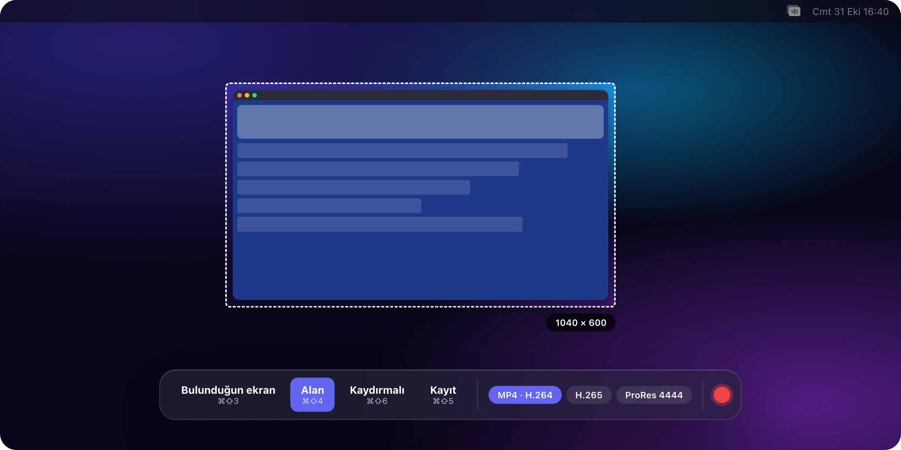

### Kaydırmalı ekran görüntüsü

⌘⇧6 ile sayfayı kaydırın, AudioTab parçaları tek uzun bir görüntüde birleştirir.

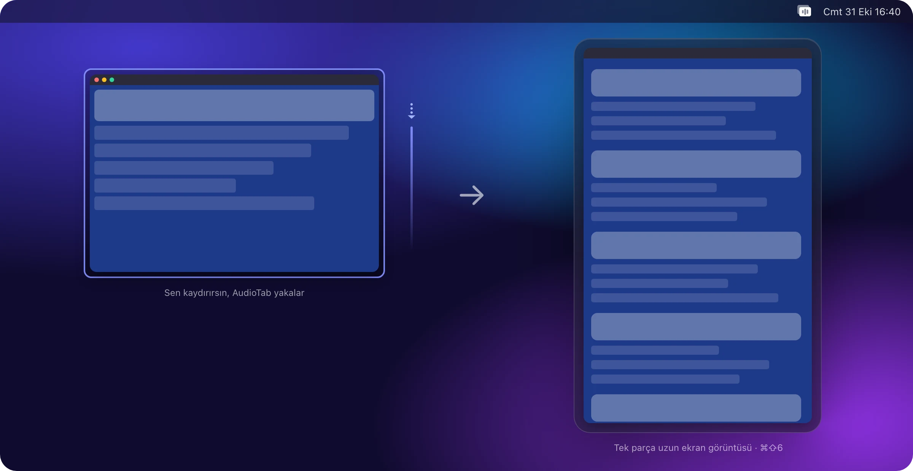

## Harici monitörler

Harici monitörlerin parlaklığını ve sesini DDC/CI ile menü çubuğundan ayarlayın. ⌘⇧< harici ekranları tamamen karartır; isterseniz o sırada klavye de kilitlenir.


## Küçük ama kullanışlı

Farenin yan tuşları Finder'da geri ve ileri gider. Bir dosyayı Dock'taki uygulamanın üstüne getirdiğinizde uygulama beklemeden öne gelir.

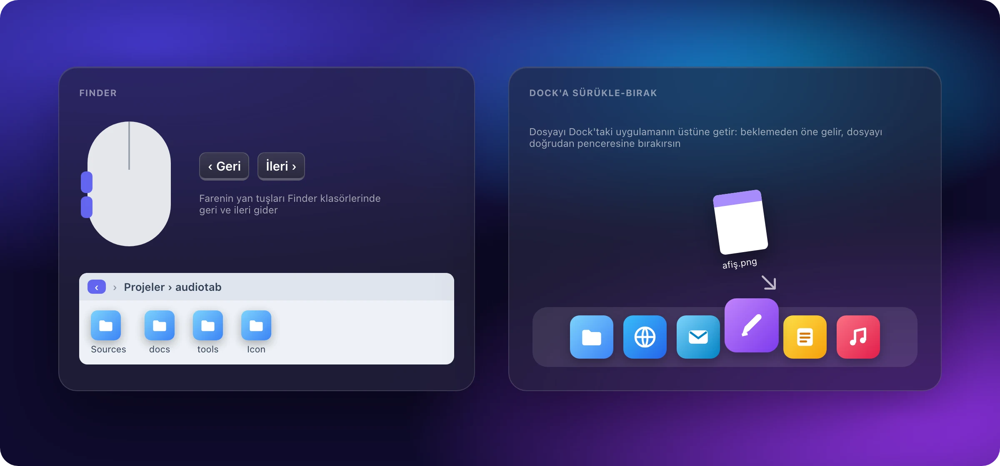

Bir uygulama klavyeyi güvenli giriş moduna aldığında (parola alanları, Terminal'in güvenli klavye girişi) macOS tuşları her uygulamadan gizler. AudioTab bunu fark eder, ⌘Tab'ı geçici olarak macOS'a bırakır ve kilit kalkınca geri alır.

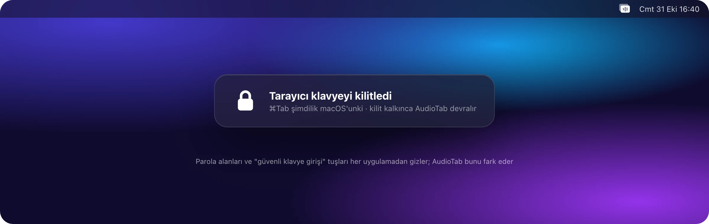

## Ayarlar

Ses, Pencereler, Ekran, İzinler, Genel ve Sürümler sekmeleri. İzinler sekmesi neyin eksik olduğunu ve neden gerektiğini gösterir.

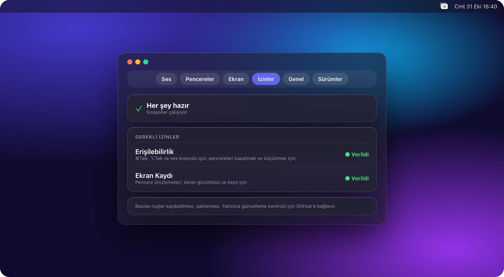

## Güvenle kurulur, güvenle güncellenir

AudioTab Apple Developer ID ile imzalı ve Apple tarafından notarize edilmiş olarak dağıtılır. "Apple could not verify…" uyarısı çıkmaz. Güncellemeler yalnızca GitHub'dan, yalnızca HTTPS ile iner ve kurulmadan önce imzası, Team ID'si ve notarize durumu doğrulanır.

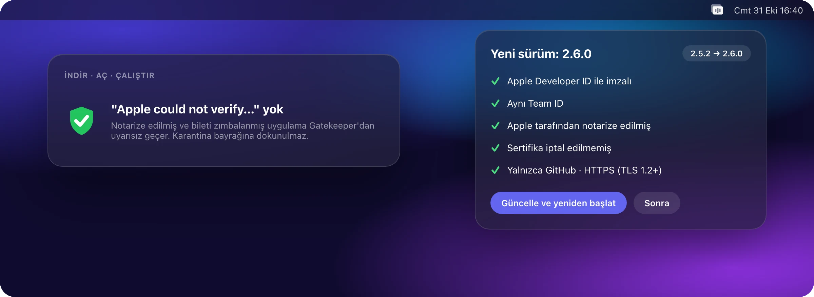

## Kurulum

### Elle

[Son sürümden](https://github.com/demirciemre/audiotab/releases/latest) `AudioTab.zip` dosyasını indirin, açın ve `AudioTab.app`'i **Uygulamalar** klasörüne taşıyın.

### Komut satırından

Betik önce indirilir, okuyabilirsiniz, sonra çalıştırılır. Apple imzasını ve Team ID'yi denetler, karantina bayrağına dokunmaz.

```sh
curl -fsSL https://raw.githubusercontent.com/demirciemre/audiotab/main/install.sh -o install.sh
```

```sh
bash install.sh
```

### Kaynaktan

Xcode komut satırı araçları yeterlidir. Yerelde derlenen kopya kendini güncellemez; `git pull` ile kodu çekip yeniden derleyerek güncellenir.

```sh
./build.sh --install
```

### İlk açılış

1. **Sistem Ayarları › Gizlilik ve Güvenlik** altında **Erişilebilirlik** ve **Ekran Kaydı** izinlerini verin. Ekran Kaydı'ndan sonra uygulamayı bir kez kapatıp açın.
2. AudioTab Dock'ta görünmez; ayarlara menü çubuğundaki simgesinden ulaşılır.

## Neden bu sürüm?

AudioTab, [debelemez/AudioTab](https://github.com/debelemez/AudioTab) (MIT) temel alınarak bağımsız olarak geliştiriliyor. Özellikler aynı, fark güven zincirinde:

| | Özgün | AudioTab (bu repo) |
|---|---|---|
| İmza | Kendinden imzalı sertifika | Apple **Developer ID**, hardened runtime, güvenli zaman damgası |
| Gatekeeper | "Apple could not verify…" uyarısı; karantina `xattr` ile siliniyor | **Notarize** edilmiş ve bileti zımbalanmış; uyarısız açılır |
| Güncelleme doğrulaması | Sabit SHA-1 parmak izi | Apple köküne bağlı Developer ID, aynı Team ID, `notarized` şartı, iptal denetimi |
| Ağ | `URLSession.shared` | Çerezsiz ve önbelleksiz oturum, yalnızca GitHub, yalnızca HTTPS (TLS 1.2+) |
| CI | Sertifika sisteme `trustRoot` olarak ekleniyor | Hiçbir kök eklenmez; anahtarlar yalnızca sürüm etiketinde açılır; action'lar SHA'ya sabit |
| Kurulum | `curl … \| bash`, karantina siliniyor | İndir, oku, çalıştır; `spctl` ve Team ID denetimi |

Güvenlik denetiminin özeti: [docs/security-audit.md](docs/security-audit.md).

## Gizlilik

- Basılan tuşlar kaydedilmez ve saklanmaz. Tuş yakalayıcı yalnızca tuş kodunu ve değiştirici tuşları okur.
- Ekran görüntüsü yalnızca siz bir kısayola bastığınızda alınır. AudioTab'ın kendi panelleri ekran paylaşımında görünmez.
- Uygulama yalnızca güncelleme kontrolü için GitHub'a bağlanır.

## Gereksinimler

macOS 13 ve üstü, Apple Silicon ve Intel. Pencere önizlemeleri ScreenCaptureKit'in ekran görüntüsü API'si nedeniyle macOS 14 gerektirir; macOS 13'te panel simgelerle açılır.

## Geliştirme

```sh
./build.sh              # Apple Silicon için derler
./build.sh --universal  # Apple Silicon + Intel
./build.sh --install    # derler, /Applications'a kurar ve açar
```

- Simge [Icon/AppIcon.icon](Icon/AppIcon.icon) içinde Icon Composer dosyası olarak durur. `tools/make_icon.sh` derler, `tools/icon_review.sh` tüm görünümleri gösterir. Web ve doküman için SVG halleri (renkli, tek renk siyah/beyaz ve `currentColor`) [docs/brand](docs/brand) klasöründe.
- README görselleri [tools/readme-art](tools/readme-art) içindeki sahnelerden üretilir: `tools/readme-art/render.sh`.
- Değişiklikler [CHANGELOG.md](CHANGELOG.md) içinde `[Unreleased]` altında birikir. Sürüm etiketi atılınca CI imzalar, notarize eder ve `AudioTab.zip`'i Release'e ekler.

## Lisans

[MIT](LICENSE). Özgün kod © 2026 Firewall Studio.
