<div align="center">
  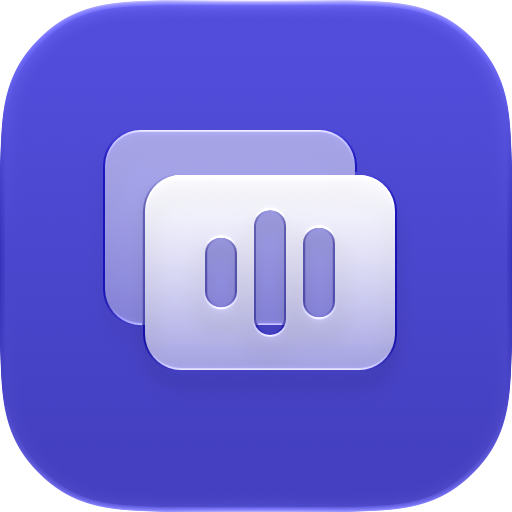
  <h1>AudioTab</h1>
  <p><b>A menu bar app that rethinks ⌘Tab window by window, switches sound output with one key, and tiles your screen.</b></p>

  <a href="https://github.com/demirciemre/audiotab/releases/latest"></a>
  
  
  <a href="LICENSE"></a>

  <p><b>English</b> · <a href="README.tr.md">Türkçe</a></p>

  <p>
    <a href="#window-switching">Window switching</a> ·
    <a href="#sound">Sound</a> ·
    <a href="#screen-tiling">Tiling</a> ·
    <a href="#screenshots-and-recording">Screenshots</a> ·
    <a href="#external-displays">Displays</a> ·
    <a href="#install">Install</a>
  </p>
</div>

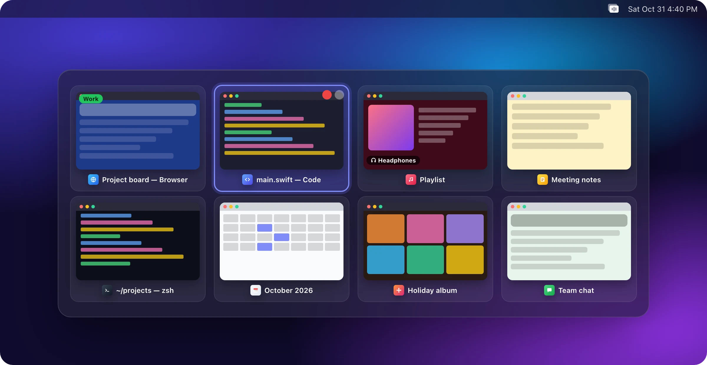

> [!NOTE]
> The images are drawn illustrations of each feature, not screenshots. App names and icons are generic.

## Window switching

### Windows, not apps

⌘Tab shows every open window as its own card, including windows on other desktops, full-screen windows and separate browser profiles. Hold ⌘ and press Tab to move along; release to bring that window forward. The panel is on screen 60–95 ms after the key press, and a very quick ⌘Tab switches without drawing it at all.

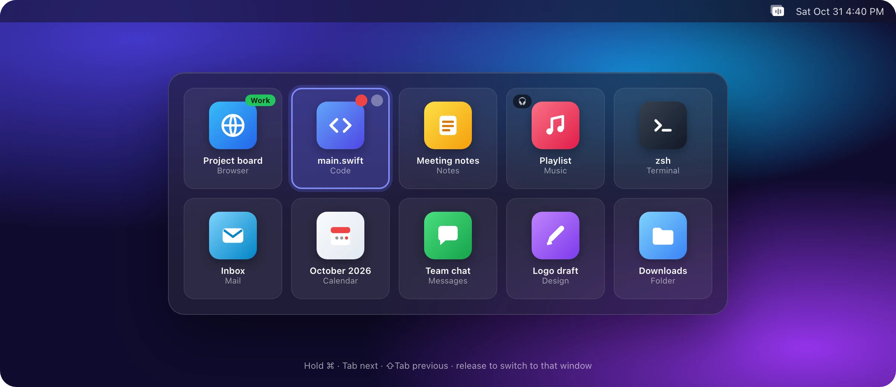

### Live previews

⌥Tab does the same with live previews of each window. With many windows, the previews stay at a readable size and the panel scrolls inside itself, with Tab or the trackpad. A line at the edge tells you how many windows are above or below.


### Grouped view

Windows are arranged in Browsers, Projects, Development, Apps and Folders columns. For project apps (video, design and music software), the project name is read from the window title. You can add apps that aren't on the list to Projects.

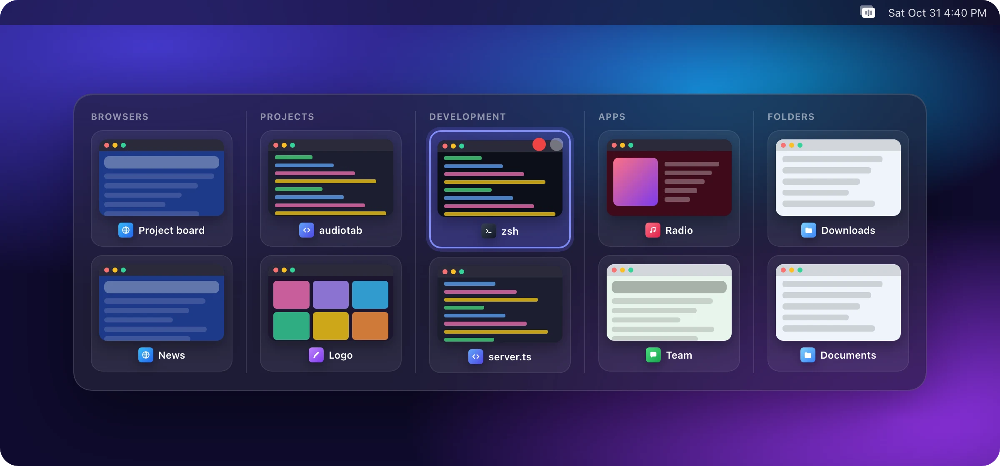

### Filter and favorites

Narrow the panel to one app's windows from the bar at the top (F and A). The sidebar on the right opens your frequent folders and Finder favorites in one click.

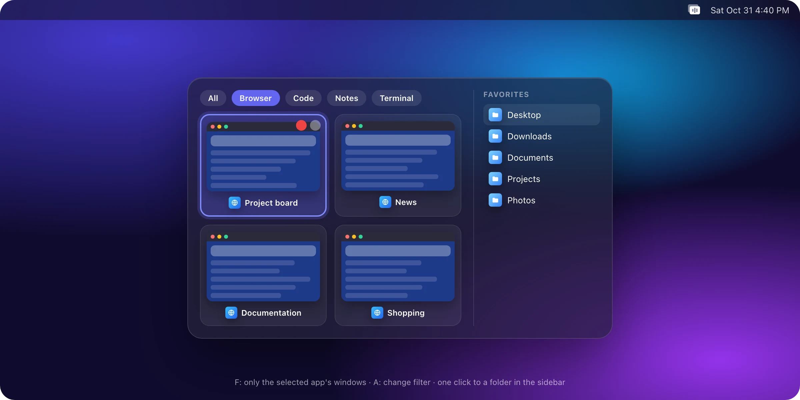

### Manage from the panel

While the panel is open, close, minimize or hide a window, quit an app, or change its sound device, all without the mouse.

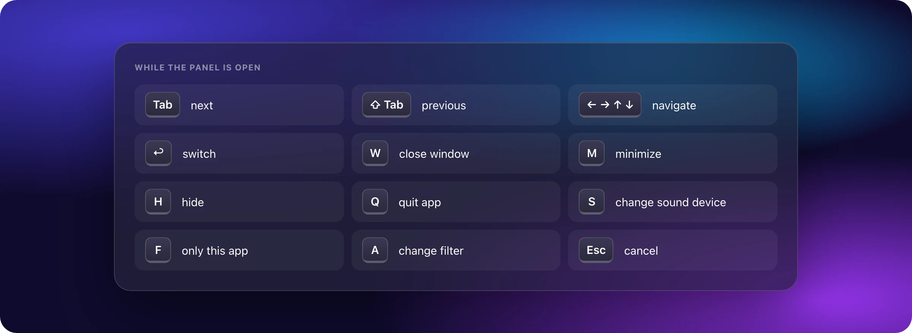

## Sound

### Sound output with one key

Hold ⌘ and tap ⇧: sound moves to the next device (or use ⌘⇪ instead). AudioTab remembers headphones you unplug and switches back when you plug them in.

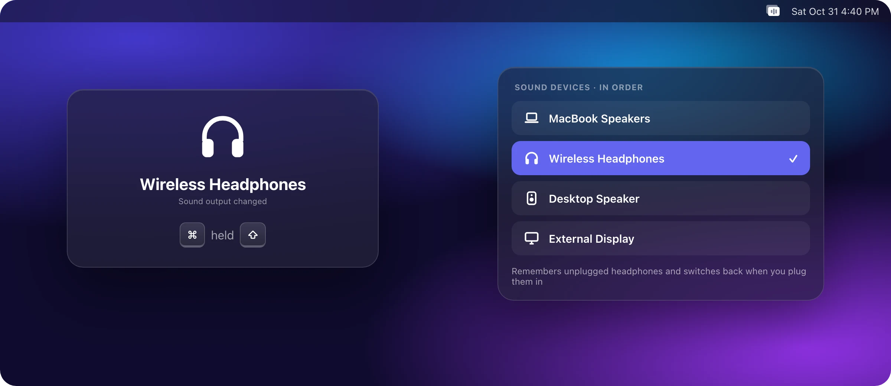

### Sound device per app

Give each app its own sound device: music on the speakers, video calls on the headphones. The assignment shows as a badge on the ⌘Tab card and changes with S in the panel.

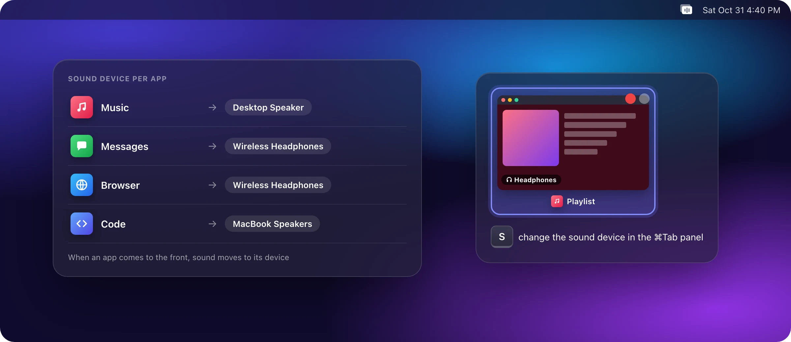

## Screen tiling

⌘< opens the picker: choose one of 9 layouts and place windows into its zones. With several displays, Tab changes the target display, and a large number on each screen shows which one is the target.

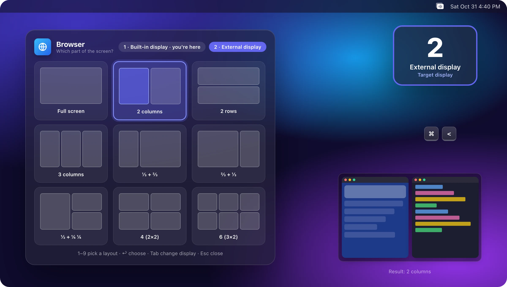

## Screenshots and recording

⌘⇧3 captures the screen under the pointer, ⌘⇧4 an area. ⌘⇧5 opens the palette and records MP4 (H.264), H.265 or ProRes 4444.

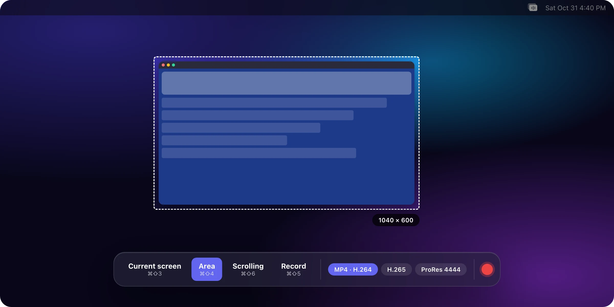

### Scrolling screenshots

Press ⌘⇧6 and scroll the page; AudioTab stitches the pieces into one long image.

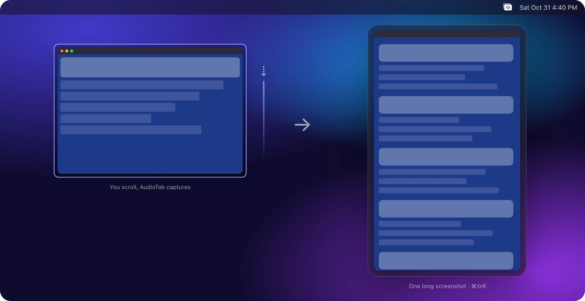

## External displays

Set the brightness and volume of external displays over DDC/CI from the menu bar. ⌘⇧< blacks out the external displays completely, and can lock the keyboard while they're dark.

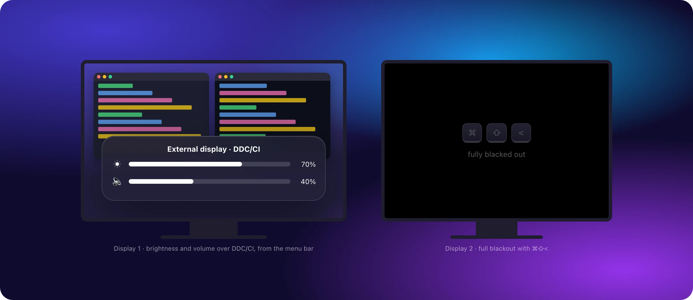

## Small but handy

The mouse side buttons go back and forward in Finder. Hold a file over an app in the Dock and the app comes forward right away.


When an app turns on secure input (password fields, Terminal's secure keyboard entry), macOS hides keystrokes from every app. AudioTab notices, hands ⌘Tab back to macOS for the moment, and takes it back when the lock lifts.

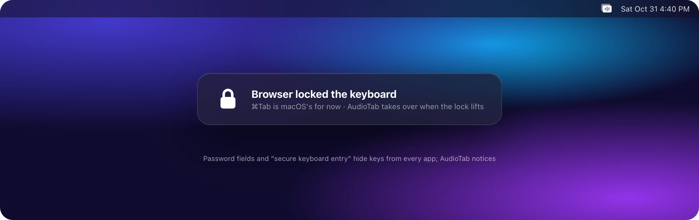

## Settings

Sound, Windows, Screen, Permissions, General and Versions tabs. The Permissions tab shows what's missing and why it's needed.

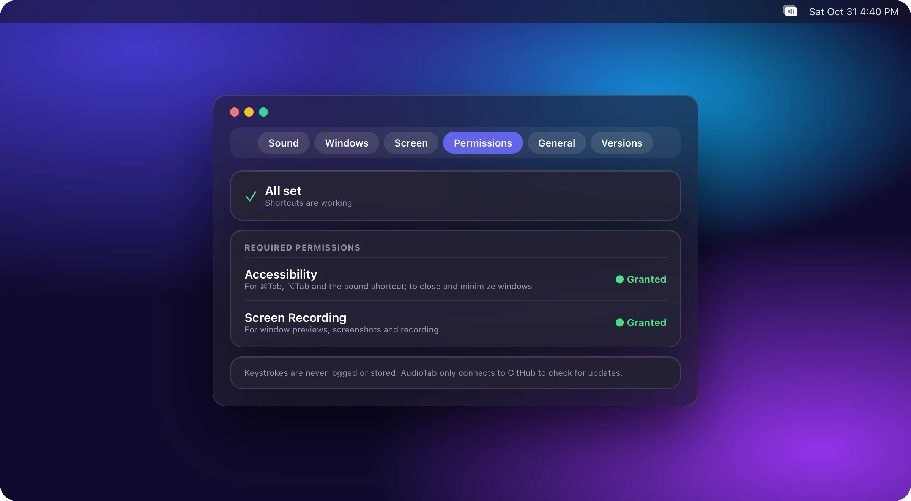

## Installs safely, updates safely

AudioTab ships signed with an Apple Developer ID and notarized by Apple, so there is no "Apple could not verify…" warning. Updates come only from GitHub, only over HTTPS, and their signature, Team ID and notarization are checked before they're installed.

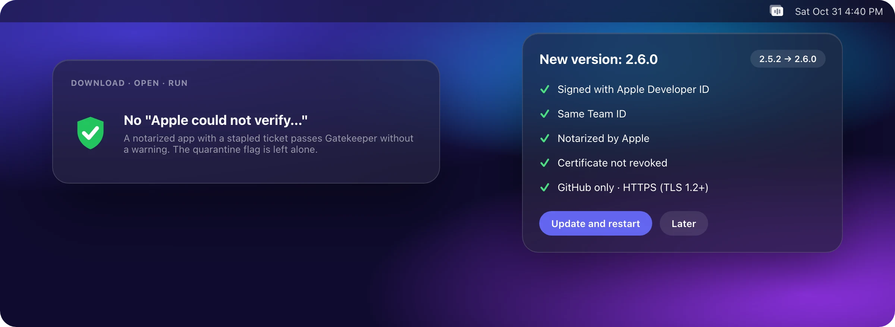

## Install

### Manually

Download `AudioTab.zip` from the [latest release](https://github.com/demirciemre/audiotab/releases/latest), unzip it, and move `AudioTab.app` to your **Applications** folder.

### From the command line

The script is downloaded first so you can read it, then run. It checks the Apple signature and Team ID and leaves the quarantine flag alone.

```sh
curl -fsSL https://raw.githubusercontent.com/demirciemre/audiotab/main/install.sh -o install.sh
```

```sh
bash install.sh
```

### From source

The Xcode command line tools are enough. A locally built copy doesn't update itself; pull the code with `git pull` and build again.

```sh
./build.sh --install
```

### First launch

1. In **System Settings › Privacy & Security**, allow **Accessibility** and **Screen Recording**. After granting Screen Recording, quit and reopen the app once.
2. AudioTab has no Dock icon; open its settings from the menu bar icon.

## Why this version?

AudioTab is developed independently, based on [debelemez/AudioTab](https://github.com/debelemez/AudioTab) (MIT). The features are the same; the difference is the chain of trust:

| | Original | AudioTab (this repo) |
|---|---|---|
| Signature | Self-signed certificate | Apple **Developer ID**, hardened runtime, secure timestamp |
| Gatekeeper | "Apple could not verify…" warning; quarantine removed with `xattr` | **Notarized** with a stapled ticket; opens without a warning |
| Update check | Pinned SHA-1 fingerprint | Developer ID chained to Apple's root, same Team ID, `notarized` requirement, revocation check |
| Network | `URLSession.shared` | Session without cookies or cache, GitHub only, HTTPS only (TLS 1.2+) |
| CI | Adds the certificate to the system as `trustRoot` | No root is added; keys are unlocked only on release tags; actions pinned to SHAs |
| Install | `curl … \| bash`, quarantine removed | Download, read, run; `spctl` and Team ID check |

Security audit summary: [docs/security-audit.md](docs/security-audit.md).

## Privacy

- Keystrokes are never logged or stored. The key listener reads only the key code and modifier keys.
- Screenshots are taken only when you press a shortcut. AudioTab's own panels don't appear in screen sharing.
- The app only connects to GitHub, to check for updates.

## Requirements

macOS 13 or later, Apple silicon and Intel. Window previews need macOS 14 because of ScreenCaptureKit's screenshot API; on macOS 13 the panel opens with icons.

## Development

```sh
./build.sh              # build for Apple silicon
./build.sh --universal  # Apple silicon + Intel
./build.sh --install    # build, install to /Applications and open
```

- The icon lives in [Icon/AppIcon.icon](Icon/AppIcon.icon) as an Icon Composer file. `tools/make_icon.sh` compiles it, and `tools/icon_review.sh` shows every appearance. SVG versions for the web and documents (colored, monochrome black/white and `currentColor`) are in [docs/brand](docs/brand).
- The README images are generated from the scenes in [tools/readme-art](tools/readme-art), in English and Turkish: `tools/readme-art/render.sh`.
- Changes collect under `[Unreleased]` in [CHANGELOG.md](CHANGELOG.md). When a release tag is pushed, CI signs, notarizes and attaches `AudioTab.zip` to the release.

## License

[MIT](LICENSE). Original code © 2026 Firewall Studio.
